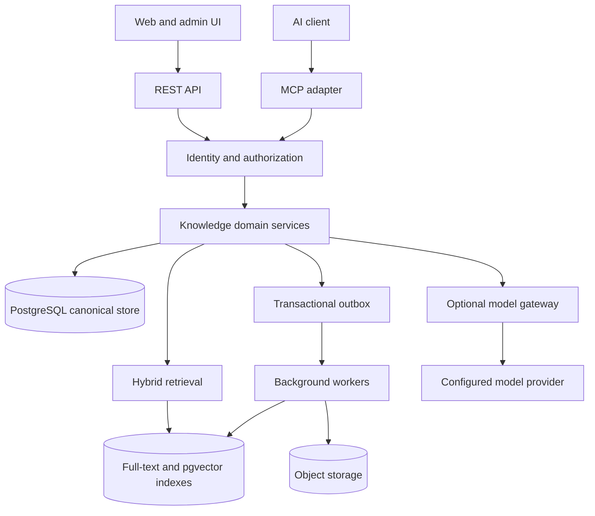
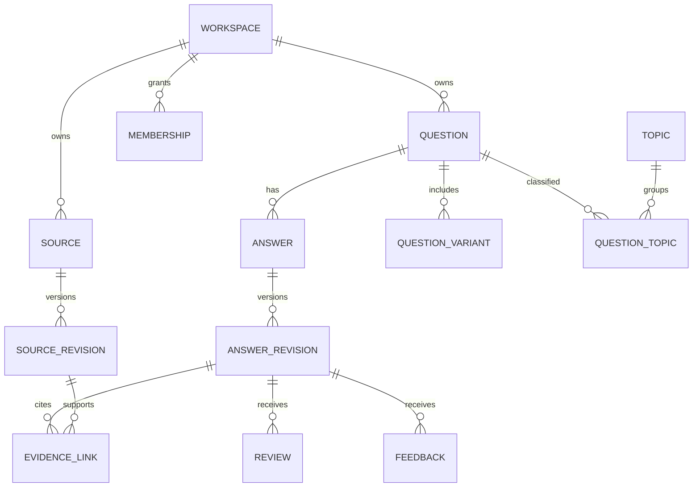
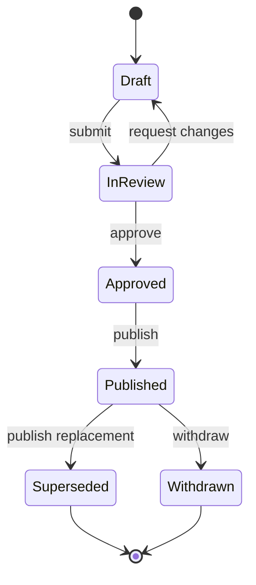
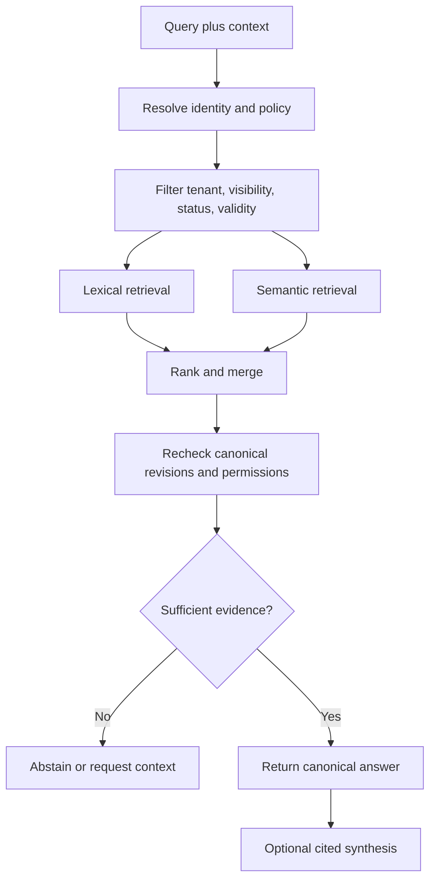

# Technical Architecture

**Status:** Proposed architecture; no implementation exists yet.

## 1. System overview



Start with a modular monolith, separately deployable background workers and an MCP transport adapter. PostgreSQL is the authoritative store. Search indexes and embeddings are derived and rebuildable. Use shared service methods for REST, UI and MCP rather than duplicating business logic.

## 2. Suggested stack

| Layer | Proposed choice |
|---|---|
| UI | Next.js, React, TypeScript |
| Backend | NestJS, TypeScript |
| Database | PostgreSQL, pgvector, native full-text search |
| Jobs | PostgreSQL outbox with worker; Redis/BullMQ only if justified |
| Identity | OpenID Connect provider; scoped access tokens |
| MCP | Official TypeScript SDK, remote Streamable HTTP transport |
| Storage | S3-compatible object storage |
| AI | Provider-neutral model and embedding gateway |
| Observability | OpenTelemetry, structured logs, metrics |
| Local environment | Docker Compose |
| CI | GitHub Actions |

Pin supported dependency and protocol versions in implementation. This stack is a proposal, not a tested compatibility matrix.

## 3. Domain model



Every tenant-owned record carries `workspace_id`; composite foreign keys or equivalent constraints prevent cross-workspace relationships. Stable IDs are UUIDs. Answer revisions include content, language, context, effective dates, author and evidence references. Publication pointers and workflow state are separate from immutable content snapshots. Use optimistic concurrency for draft updates and transactional publication.

### Example published answer representation

```json
{
  "question_id": "q_example",
  "answer_id": "a_example",
  "revision_id": "ar_example_v2",
  "question": "How do I reset my password?",
  "short_answer": "Open account settings and select Reset password.",
  "language": "en",
  "context": {"product": "Example App", "audience": "customer"},
  "publication_status": "published",
  "verification_status": "reviewed",
  "reviewed_at": "2026-11-26T00:00:00Z",
  "valid_until": null,
  "sources": [{"source_revision_id": "sr_example", "title": "Account guide", "url": "https://example.org/account"}]
}
```

Illustrative data only; production uses UUIDs and validated schemas.

## 4. Editorial state machine



Restoring older content creates a new reviewed revision, not mutation of historical records. Require configurable separation of author and approver. Expiration and access are checked at delivery time, independently of state.

## 5. REST API surface

| Method | Endpoint | Purpose |
|---|---|---|
| GET | `/v1/workspaces/{id}/questions` | List authorized questions |
| POST | `/v1/workspaces/{id}/questions` | Create question |
| GET | `/v1/questions/{id}` | Retrieve question |
| POST | `/v1/questions/{id}/answers` | Create answer draft |
| POST | `/v1/answers/{id}/revisions` | Propose revision |
| POST | `/v1/revisions/{id}/submit` | Request review |
| POST | `/v1/revisions/{id}/approve` | Approve revision |
| POST | `/v1/revisions/{id}/publish` | Publish approved revision |
| POST | `/v1/revisions/{id}/withdraw` | Withdraw revision |
| GET | `/v1/workspaces/{id}/search` | Hybrid search with filters |
| GET | `/v1/answers/{id}` | Get applicable authorized answer |
| GET | `/v1/sources/{id}` | Get authorized source metadata |
| POST | `/v1/workspaces/{id}/ask` | Optional generated answer (post-MVP) |

Specify contracts in OpenAPI, use cursor pagination and bounded query size, consistent error envelopes, idempotency keys for mutation retries and request correlation IDs. Resource IDs never confer permissions.

## 6. MCP contract

Proposed endpoint `/mcp`, using the same services and authorization as REST. Register tool schemas with bounded input and structured output where supported by the pinned protocol and SDK.

| Tool | Input | Output | Phase |
|---|---|---|---|
| `search_questions` | query, context, limit | ranked authorized IDs, excerpts, revision IDs | MVP |
| `get_answer` | question_id or answer_id, context | applicable revision, evidence, status | MVP |
| `get_sources` | answer_revision_id | authorized source metadata | MVP |
| `get_related_questions` | question_id, limit | related authorized questions | MVP |
| `ask_knowledge_base` | query, context | generated response, citations, abstention status | Later |
| `submit_feedback` | revision_id, category, comment | feedback ID | Later |
| `suggest_question` | question, context | draft ID | Later |
| `suggest_answer` | question_id, content, evidence | proposed revision ID | Later |

Resource URI examples: `knowledge://workspaces/{workspace_id}/questions/{id}` and `knowledge://workspaces/{workspace_id}/answers/{id}/revisions/{revision_id}`. Resources are authorized per read. Optional prompts may guide citation-aware answers; they do not override access policy. Tools return explicit not-found or insufficient-evidence outcomes without leaking existence of inaccessible objects. Tenant membership is derived from verified identity, not trusted from caller-provided arguments.

## 7. Retrieval and generation



Combine lexical and vector rankings using reciprocal rank fusion as a starting baseline. Apply authorization inside candidate retrieval and again against current canonical records before output. Do not send inaccessible content to a model or reranker. Cache keys include tenant, authorization context and revision; disable shared caches for sensitive results until safe invalidation is proven. Re-embed on model changes using versioned indexes. Evaluate recall and ranking against a curated query set.

## 8. Security and operations

- Authentication: validate issuer, audience, expiry and scope; implement MCP authorization requirements for the selected protocol version; never pass user tokens through to unrelated services.
- Authorization: centralized resource policy, least privilege, row-level security as defense in depth, negative tests for every interface.
- AI safety: isolate retrieved content as untrusted data, restrict tool execution, enforce budgets and timeouts, validate output citations, require review before publication.
- Ingestion: restrict outbound destinations, check redirects and size limits, scan files, record licenses and provenance.
- Operations: encrypted transport and storage, managed secrets, dependency scanning, structured audit events, restore drills and retention policies.
- Reliability: transactional outbox for indexing and webhooks, retry with backoff, dead-letter handling, idempotent consumers and index reconciliation.

## 9. Proposed repository layout

```text
qa-knowledge-platform/
  README.md
  docs/
    WHITEPAPER.md
    PROJECT_MAP.md
    ARCHITECTURE.md
    adr/
  apps/
    web/
    api/
    mcp/
    worker/
  packages/
    domain/
    authorization/
    retrieval/
    ai-gateway/
    contracts/
    ui/
  infra/
  tests/
    integration/
    security/
    evaluation/
  .github/
    workflows/
```

Application directories above are a planned layout, not included as empty implementation scaffolding in the documentation release.

## 10. Testing strategy

Unit tests cover domain invariants and applicability. Integration tests exercise PostgreSQL, migrations, permissions and publication events. Contract tests cover REST and MCP. End-to-end tests cover editor-to-reader delivery. Security tests include cross-tenant access, stale indexes, malicious imports, injection and unauthorized writes. AI evaluations use a versioned fixture set including unanswerable and conflicting questions. Load tests establish latency and capacity baselines before setting production SLOs.
