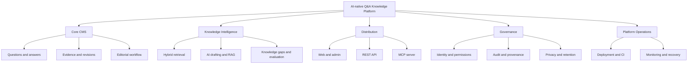
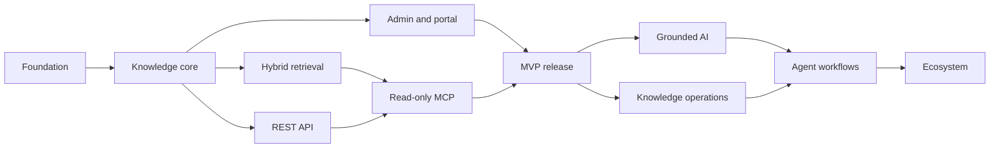

# Project Map & Development Roadmap

**Status:** Proposed · Milestones are dependency-based, not delivery commitments.

## 1. Project map

## 2. Milestones

| Milestone | Scope | Exit criteria |
|---|---|---|
| M0 — Foundation | ADRs, monorepo, CI, local environment, threat model | Clean checkout builds; tests run in CI; architecture and licensing decisions recorded |
| M1 — Knowledge core | Workspace, identity, Q&A, sources, revisions, review | Editor creates a sourced draft; reviewer publishes; old revision remains auditable |
| M2 — Search and delivery | Hybrid retrieval, portal, REST, read-only MCP | Same authorized published answer retrievable from UI, REST and MCP; withdrawn answers excluded |
| M3 — AI assistance | RAG, import, draft proposals, duplicate suggestions | Grounded output evaluated against fixture corpus; insufficient evidence triggers abstention |
| M4 — Knowledge operations | Freshness reviews, feedback, gap detection, multilingual variants | Review queue and reporting work; translations maintain independent review state |
| M5 — Agentic workflows | Scoped MCP proposals, approval, integration webhooks | Agent can propose but cannot bypass approval; retries are idempotent |
| M6 — Ecosystem | Connectors, federation, advanced enterprise features | Separate product validation and security review before release |

**MVP release boundary:** M0–M2. Do not require a generative LLM to operate the core CMS.

## 3. Initial GitHub backlog

Each row can become an issue or epic. P0 is necessary for MVP; P1 follows MVP or improves it when capacity permits.

| ID | Issue | Priority | Depends on | Acceptance criteria |
|---|---|---|---|---|
| F01 | Establish monorepo and CI | P0 | — | Lint, build and test execute on pull requests |
| F02 | Record architecture and license ADRs | P0 | — | ADRs cover storage, auth, MCP and licensing |
| F03 | Threat model and test fixtures | P0 | F02 | Tenant boundaries and abuse cases documented; synthetic corpus seeded |
| G01 | Workspace identity and authorization | P0 | F01,F03 | Cross-tenant access denied in API and service tests |
| K01 | Question, answer and topic schemas | P0 | F01,G01 | Migrations and CRUD with stable IDs |
| K02 | Source and evidence records | P0 | K01 | Answer revision references source revisions |
| K03 | Immutable revision history | P0 | K01,K02 | Published revisions cannot be overwritten |
| K04 | Review and publication state machine | P0 | K03,G01 | Unauthorized publication rejected; withdrawal effective immediately |
| G02 | Audit trail | P0 | G01,K04 | Actor, action, target and time recorded without secrets |
| U01 | Admin editor and review queue | P0 | K04 | Create, submit, approve and withdraw from UI |
| S01 | Lexical search | P0 | K04 | Published authorized results only; pagination works |
| S02 | Vector and hybrid retrieval | P0 | S01 | Embeddings indexed; ranking compared with lexical baseline; access filters enforced |
| D01 | Versioned REST API | P0 | K04,S01 | OpenAPI contract and integration tests |
| D02 | Public/private knowledge portal | P0 | D01 | Accessible canonical Q&A pages; private content not indexed |
| D03 | Read-only remote MCP server | P0 | D01,S02 | Discovery, search and get-answer work with a compatible client |
| O01 | Backup, restore and deployment | P0 | F01,K03 | Restore tested; deployment and rollback documented |
| O02 | Monitoring and release gates | P0 | D03,O01,G02 | Security suite and end-to-end tests pass; health metrics available |
| A01 | Provider abstraction | P1 | M2 | Model calls bounded by policy, budget and timeout |
| A02 | Grounded answer generation | P1 | A01,S02 | Responses contain evidence or explicit abstention |
| A03 | Document ingestion pipeline | P1 | K02,A01 | Import creates drafts; malicious input treated as data |
| A04 | Draft and duplicate suggestions | P1 | A01,K04 | Proposals reviewable and reversible |
| A05 | Evaluation suite | P1 | A02 | Versioned benchmark for relevance, support and abstention |
| K05 | Feedback and freshness queue | P1 | K04 | Feedback and expired reviews create tasks |
| D04 | Agent proposal tools | P1 | D03,K04,G02 | Scoped writes create drafts only; idempotency tested |

## 4. Dependency map

## 5. GitHub project configuration

Suggested board columns: Backlog, Ready, In progress, Review, Blocked, Done. Use fields for milestone, priority, effort, owner and target release. Suggested labels: `area:cms`, `area:search`, `area:ai`, `area:mcp`, `area:security`, `area:frontend`, `area:infra`, `type:epic`, `type:bug`, `type:adr`, `priority:p0`, `priority:p1`.

## 6. Release gates

- No known critical security defects; zero unauthorized content disclosure in access-control tests.
- End-to-end editorial and retrieval workflows pass with a reproducible fixture corpus.
- MCP integration tested against the pinned protocol version and at least one compatible client.
- Publication and withdrawal behavior consistent across channels, even during indexing delay.
- Backup restore, migration rollback strategy, dependency scanning and operational runbook verified.
- AI release additionally requires approved evaluation thresholds, explicit uncertainty handling and data-processing policies.

## 7. Risks and decisions

| Risk | Mitigation |
|---|---|
| Excessive scope | Keep M0–M2 narrow; validate one pilot use case |
| AI hallucination | Canonical answers first; citations, evaluations and abstention |
| Tenant leakage | Authorization before retrieval and again on returned records |
| Stale search index | Transactional outbox, retries, authoritative publication check |
| MCP changes | Pin protocol and SDK; contract tests; adapter isolation |
| Provider lock-in | Model gateway and rebuildable embeddings |
| Content rights | Source policy and provenance; avoid unauthorized copying |

Open decisions: project name, license, initial user segment, hosting model, identity provider, supported languages, budget and team size. No calendar or effort estimates are assumed.
